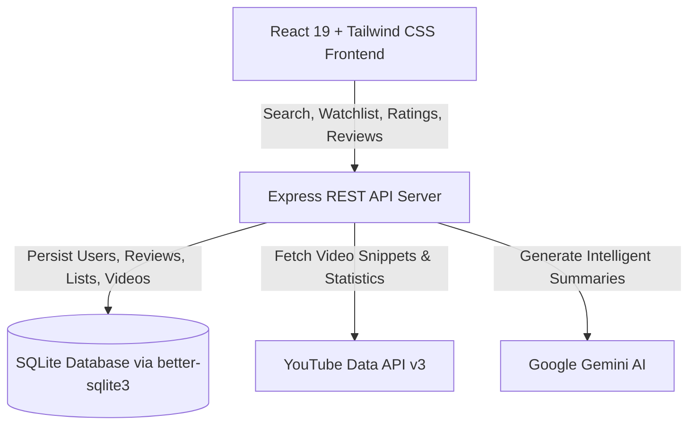

# Youtuboxd

### The social network for YouTube enthusiasts. Track, log, review, and curate creator content with cinephile precision.

---

## Overview

**Youtuboxd** brings the beloved social film-tracking experience of **Letterboxd** to the world of YouTube. Long-form video essays, deep-dive documentaries, independent short films, lectures, and creator projects deserve more than a fleeting algorithm feed—they deserve discussion, thoughtful reviews, rating histograms, and personal diaries.

With Youtuboxd, viewers can log what they watch, rate videos with half-star precision, build custom watchlists, and discover top-tier video essays recommended by other curious minds.

> [!NOTE]
> Designed from the ground up with Letterboxd's signature dark palette (`#14181c`), crisp typography, and sleek green/orange/blue visual cues.

---

## Key Features

### 🎬 Film-Grade Video Detail Pages
- **Cinematic Backdrops**: Panoramic ambient banners generated from high-resolution thumbnails with subtle fade gradients.
- **Creator & Video Metadata**: Dynamic extraction of title, channel creator, upload year, ISO-8601 duration formatted cleanly, view counts, and engagement stats.
- **AI-Powered Overviews**: Gemini integration provides concise, objective narrative summaries for every indexed video.
- **Tabbed Video Intel**: Switch seamlessly between video details, tags, channel info, and community statistics.

### ⭐ Half-Star Rating Engine & Distribution
- **Granular 10-Point Rating**: Rate from 0.5 to 5.0 stars with smooth interactive hover feedback.
- **Community Histograms**: Real-time rating distribution bars showcasing community sentiment and average score calculation.
- **Exact Action Panel**: Instant toggles for **Watched / Logged** (Green), **Liked** (Orange), and **Watchlist** (Blue).

### 🔍 Direct URL Import & Discovery
- **Instant YouTube URL Parsing**: Paste any YouTube link (`watch?v=`, `youtu.be`, or embed URLs) to automatically extract metadata and catalog the video in seconds.
- **Live Search & Trending**: Search across YouTube's library or browse curated popular videos from the home dashboard.

### 📚 Diaries, Lists & Social Graph
- **Personal Diary**: Keep a chronological diary of everything you watch with dates, personal notes, and ratings.
- **Custom Curated Lists**: Group favorite video essays, technical lectures, or mini-series into shareable public or private lists.
- **User Activity & Profiles**: Follow other curators, view their recent logs, and share reviews.

---

## Design System & Aesthetics

Youtuboxd meticulously respects the visual language and typography hierarchy made iconic by film discovery platforms:

| Element | Visual Treatment |
| :--- | :--- |
| **Canvas Background** | Deep obsidian `#14181c` with subtle `#2c3440` structural borders |
| **Action Panel** | Slate `#445566` floating card with crisp icon states |
| **Accents** | Signature Green `#00e054` for watched logs & high ratings, Orange `#ff8000` for likes, Light Blue `#40bcf4` for lists & watchlists |
| **Typography** | Editorial serifs for headlines paired with clean geometric sans-serifs for metadata and stats |

---

## Architecture Overview

- **Frontend**: React 19, Vite, Tailwind CSS v4, Lucide Icons, React Router v7.
- **Backend**: Node.js, Express, SQLite via `better-sqlite3`, JWT security, bcrypt password hashing.
- **Integrations**: Google YouTube Data API v3, Google Gemini API for auto-generated video synopses.
